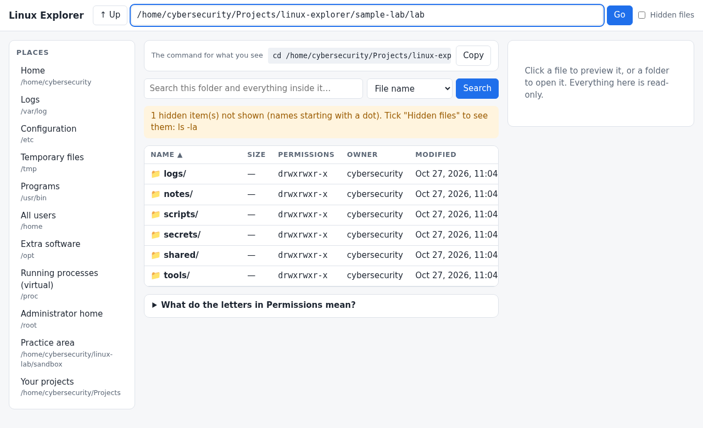
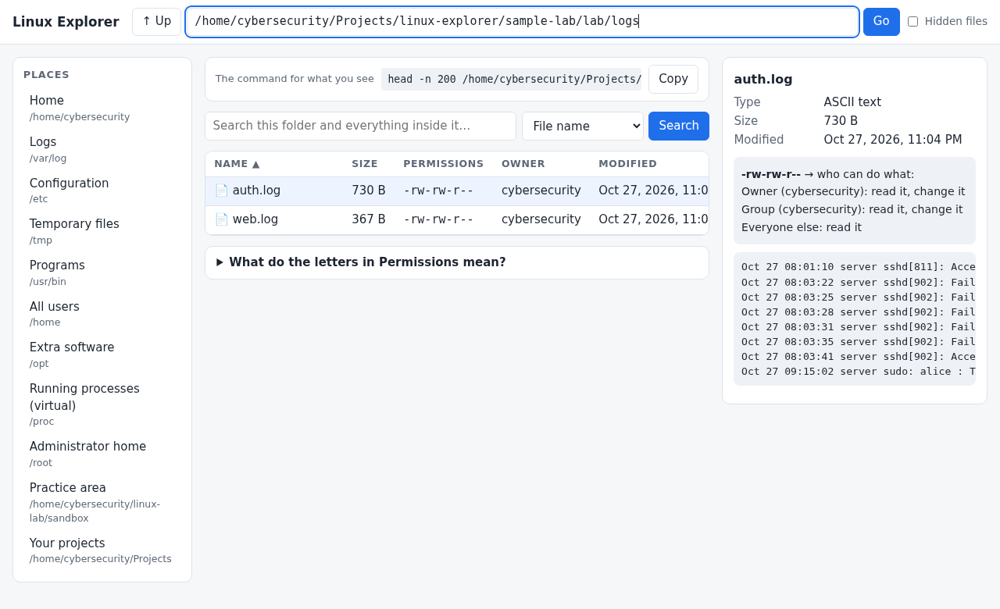
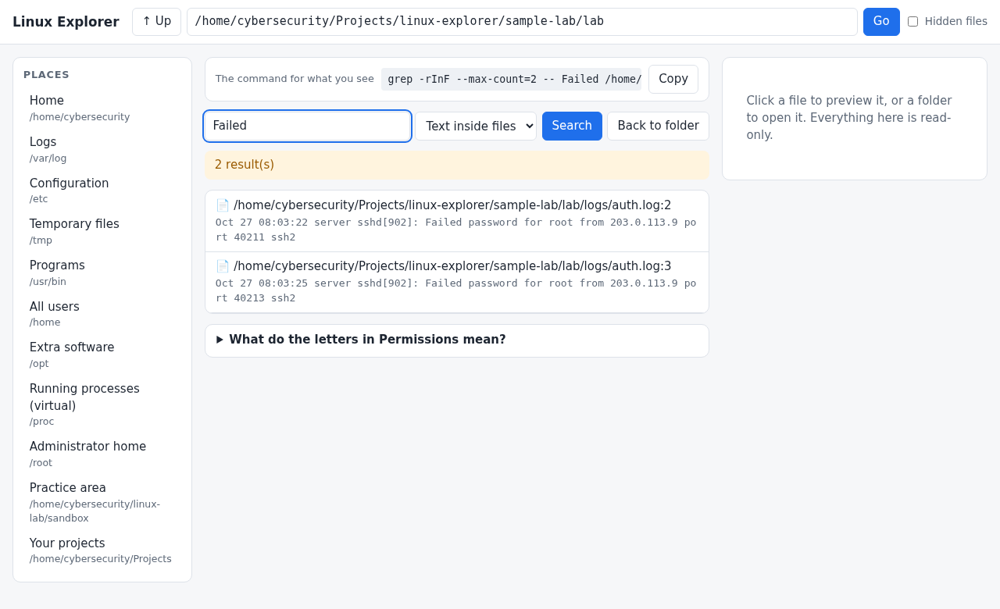
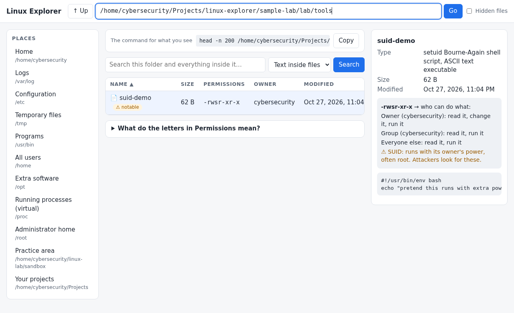

# Linux Explorer

**Browse your files like a normal app, and see the Linux command behind every click.**

Linux Explorer is a small, read-only file and folder browser for Linux. It was built to help people learning cybersecurity (for example, aiming for a SOC analyst role) get comfortable with the terminal: every folder you open and every search you run shows the exact command that does the same thing.



- **See the command.** Click a folder and the bar at the top shows `cd /path && ls -l /path`. Copy it, paste it into a terminal, and you have learned it.
- **Permissions in plain English.** Click a file and it says "Owner can read, change. Everyone else: read."
- **Spot risky things.** Files anyone can edit and files that run with extra power (SUID) get a warning.
- **Search like an analyst.** Search by file name (`find`) or by text inside files (`grep`).
- **Safe by design.** It is read-only and only runs on your own computer. It cannot change, delete or upload anything.

## Quick start

You need Linux and Python 3 (tested with Python 3.14). Nothing else to install.

```bash
git clone https://github.com/bestrateconstruction1-droid/github_linux_explorer.git
cd github_linux_explorer
./install.sh
```

Then open it any of these ways:

- search **Linux Explorer** in your application menu,
- double-click the **Linux Explorer** icon on your desktop (if it asks, choose "Trust" or "Allow launching"),
- or type `linux-explorer` in a terminal.

Prefer not to install? Run it straight from the folder: `python3 explorer.py`

It opens in your web browser at `http://localhost:8765`. Closing the browser tab does not stop it. If you started it from a terminal, press `Ctrl+C`. If you opened it from the menu or desktop icon, it keeps running quietly until you log out, or you can stop it with `pkill -f explorer.py`.

## How to use it



1. **Move around.** Click a folder to open it. Click **↑ Up** to go to the parent folder (the same as `cd ..`).
2. **Type a path.** Put a path like `/var/log` in the bar at the top and press **Go**. This is how absolute paths work in the terminal.
3. **Read the command.** The grey bar above the list always shows the command for what you are looking at. Press **Copy** to use it in a terminal.
4. **Preview a file.** Click a file to see the start of it on the right. Text files show as text. Programs and other binary files show their raw bytes, and the first few bytes tell you what kind of file it is.
5. **Understand permissions.** The panel on the right spells out who can read, change or run the item. The letters in the **Permissions** column are explained at the bottom of the page.
6. **Show hidden files.** Tick **Hidden files** to see items starting with a dot, like `.ssh` and `.bashrc` (the same as `ls -a`).
7. **Jump to important places.** The **Places** list on the left links to folders a security analyst checks often, such as `/var/log` (logs), `/etc` (settings) and `/tmp` (anyone can write here). Hover over one to see why it matters.



8. **Search.** Type a word in the search bar, choose **File name** or **Text inside files**, and press **Search**. It searches the current folder and everything inside it. Click a result to jump to it.

## Try it safely: the practice lab

The repository includes a make-believe server with fake logs and files that have interesting permissions. Create it with:

```bash
./sample-lab/setup.sh
```

Then open Linux Explorer, paste the path it prints into the bar, and press **Go**. Work through the exercises in [docs/LEARNING-EXERCISES.md](docs/LEARNING-EXERCISES.md). They go from "who failed to log in?" to "which files are dangerous?", with the terminal command for each.



## Reading permissions

A line like `-rwxr-xr--` has four parts:

| Part | Example | Meaning |
|---|---|---|
| Type | `-` | `-` file, `d` folder, `l` link |
| Owner | `rwx` | the owner can read, write and run |
| Group | `r-x` | the group can read and run |
| Everyone else | `r--` | everyone else can only read |

`r` = read, `w` = write (change), `x` = run (or "enter", for a folder), `-` = not allowed. For folders: `r` lists what is inside, `w` adds or removes files, `x` lets you open it.

Warnings you may see:

- **Anyone can change this.** The file is writable by every user. Attackers like these.
- **SUID.** The program runs with its owner's power, often root. A common thing to hunt for in a security review.
- **Sticky bit.** Normal for `/tmp`: people can only delete their own files there.

## Privacy and safety

- **Read-only.** There is no way to write, delete, rename or upload through the app. The server rejects every request except reading.
- **Local only.** It listens on `127.0.0.1` and refuses requests that are not addressed to `localhost` or `127.0.0.1` on its own port. This stops other websites from using your browser to read your files.
- **No internet.** It makes no network requests and collects nothing.
- **Hostile file names are safe.** Names and file contents are always shown as plain text, never as code, and commands shown to you are quoted so they are safe to copy.
- **It sees what you can see.** It runs as you, so it can only open what your account can open. For protected files it tells you what a terminal command with `sudo` would do.

Limits: previews show the first 64 KB; searches stop after about 6 seconds or 200 results and skip virtual folders like `/proc`; very large folders show the first 5,000 items.

## Troubleshooting

| Problem | Fix |
|---|---|
| The browser did not open | Go to `http://localhost:8765` yourself. |
| "Address already in use" | Another copy or program uses port 8765. Close it, or run with another port: `LINUX_EXPLORER_PORT=9000 linux-explorer` |
| `linux-explorer: command not found` | Add `~/.local/bin` to your PATH, or open a new terminal after installing. |
| Desktop icon says it is untrusted | Right-click it and choose **Allow Launching**, or use the application menu instead. |
| "You do not have permission" | Your account cannot open that item. In a terminal, `sudo ls /path` or `sudo cat /path` shows it. |

## Development

```bash
python3 -m unittest discover -s tests -v
```

The code is one Python file (`explorer.py`) plus a small page in `static/`, with no dependencies. Tests run automatically on GitHub for every push.

Ideas for later: bookmarks, a file-hash viewer, recently modified files, and an exercise checklist inside the app. Contributions are welcome.

## License

MIT. See [LICENSE](LICENSE).
